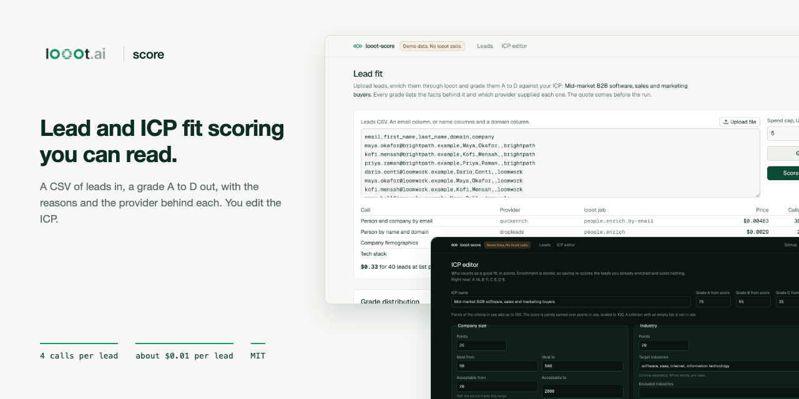
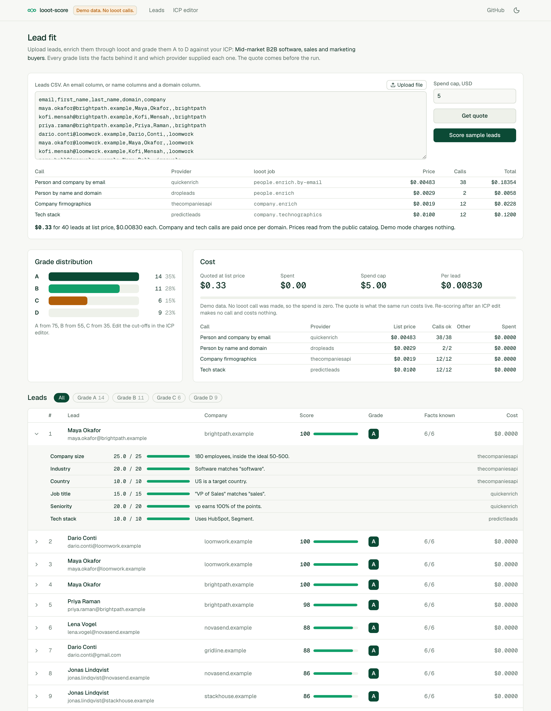
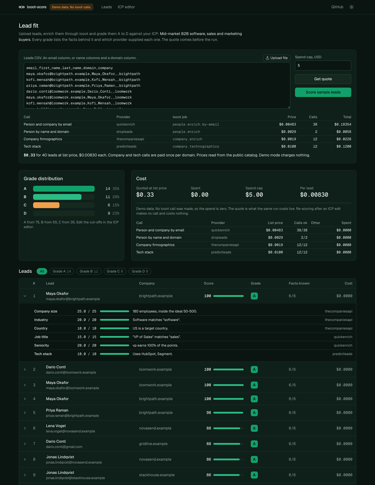
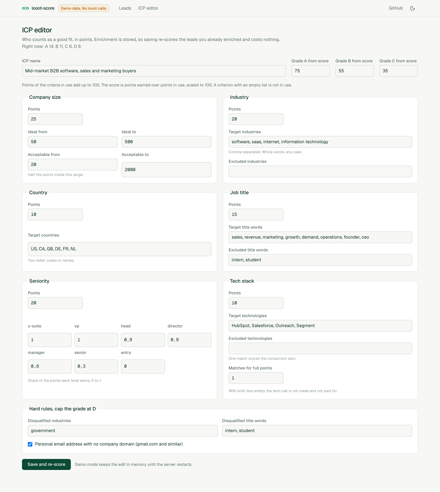
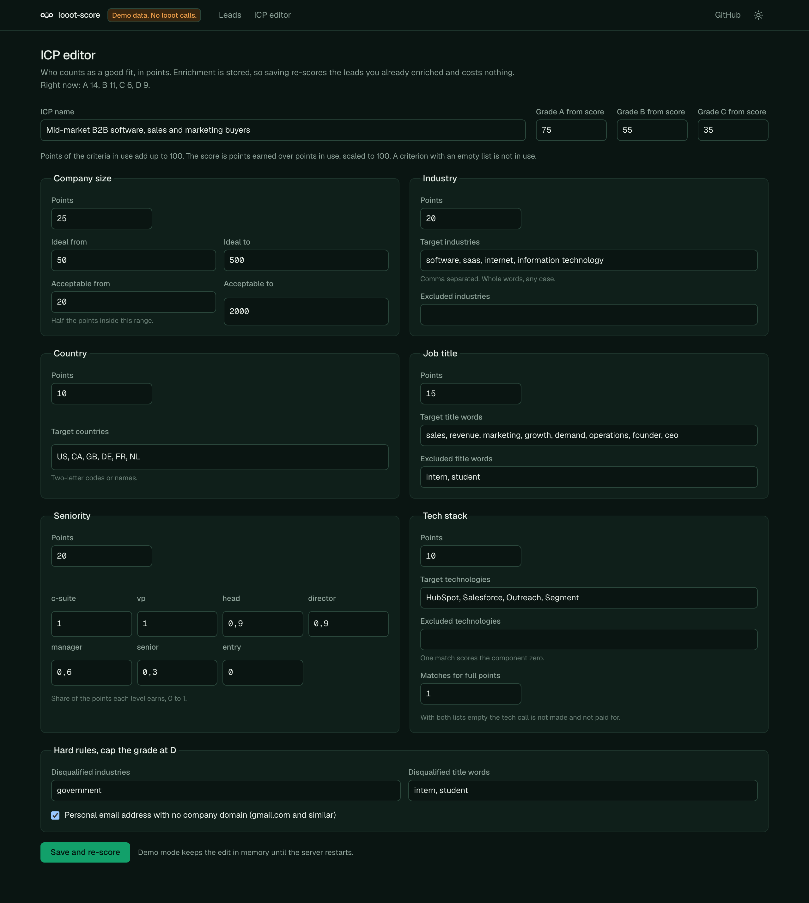

<p align="center"></p>

# looot-score

> **Security notice.** Versions 0.1.2 and older had no admin sign-in. Anyone who could reach a deployed instance could start paid runs with a spend cap of their own choosing, rewrite the ICP file, and read the stored enrichment. If you run 0.1.2 or older on a reachable host, upgrade to 0.1.3 and set `LOOOT_SCORE_ADMIN_PASSWORD`. See [Securing a deployment](#securing-a-deployment).

[](LICENSE) [](https://github.com/loootai/looot-score/releases) [](https://docs.looot.ai)

An open-source alternative to [MadKudu](https://www.madkudu.com) for lead and ICP fit scoring. MadKudu's own pricing page redirected to HG Insights and could not be read (checked 2026-10-10), so no price is stated here as fact. Third-party listings give an estimate of about $999 a month for the entry plan; treat it as unconfirmed. looot-score enriches a CSV of leads through [looot](https://looot.ai), scores each one against an ICP you edit, and returns a grade A to D with the reasons.



## What it does

Upload a CSV with an email column, or name columns and a domain column. For each lead it fetches the person (title, seniority) and the company (industry, headcount, country, tech stack) from named providers, then scores six criteria from the ICP and grades the lead.

- Every grade lists the criteria behind it, the points each earned, the fact found and the provider that supplied it.
- A fact no provider returned earns nothing and is marked unknown. Nothing is guessed.
- Enrichment is stored. Editing the ICP re-scores every stored lead at no cost and with no looot call.
- The quote comes first. A per-run spend cap is enforced before each call. A company or tech stack is fetched once per domain, whatever the number of leads. A call still running when waiting stops is `pending`, never "failed at $0".
- Hard rules cap the grade at D: a disqualified industry or title, or a personal mailbox with no company domain.

Three ways to run it: a demo with sample leads, a headless CLI, and a web UI on the same engine.

| Page | Light | Dark |
| --- | --- | --- |
| Upload, quote, grades, lead table with reasons |  |  |
| ICP editor |  |  |

## What you need

- Node.js 20.9 or later to run the app and the CLI (Next.js 16 requires it). The tests need Node 22.12 or later (vitest 5). The repo has no `engines` field or `.nvmrc`; I ran everything on Node 24.18.
- Git and npm.
- For real runs only, a looot account and token. Sign up at https://looot.ai/auth/sign-up. Then either run `npm i -g looot` and `looot login`, which opens a browser approval, or open the looot web app, go to Settings, "Agent tokens" and create one ([sign-in docs](https://docs.looot.ai/get-started/sign-in)). With no browser (CI), create the token in Settings > Agent tokens and `export LOOOT_TOKEN=...`.
- The token needs the scopes `runs.execute`, `catalog.read`, `runs.read` and `usage.read`.
- A funded balance. The minimum top-up is $5 and signing up adds no credit ([money docs](https://docs.looot.ai/money)).

No other account is used. There is no Supabase, no database and no LLM key.

## Try it in one minute

```bash
git clone https://github.com/loootai/looot-score && cd looot-score
npm install --ignore-scripts
npm run demo
```

Open http://localhost:3272. The demo has no sign-in and shows a "Demo, no sign-in" badge. It refuses to start if `LOOOT_TOKEN` is set or a state file exists, unless you also set an admin password. The demo scores 40 generated leads on the reserved `.example` domain, needs no token, makes no network call and costs nothing. Stop it with Ctrl+C.

Prefer the terminal? `npm run score -- --demo` prints the grade counts and writes the reports to `./out`.

## Run it with your own data

The web UI reads `.env.local`, the CLI does not. For the CLI, `export` the variables in your shell.

```bash
cp .env.example .env.local     # web UI only
```

| Variable | Needed | What it does | Where to get it |
| --- | --- | --- | --- |
| `LOOOT_TOKEN` | Required for real runs | Your looot key. Not needed for `--demo` or `--dry-run`. | looot Settings > Agent tokens, or `looot login` |
| `LOOOT_API_URL` | Optional | Overrides the API base. Default `https://api.looot.ai`. | Leave unset |
| `LOOOT_SCORE_ADMIN_PASSWORD` | Required outside the demo | Admin password, 12 characters or more. Without it the admin pages and API are closed and `/login` shows a setup page. | Choose one |
| `LOOOT_SCORE_ADMIN_PASSWORD_HASH` | Alternative | `scrypt$salt$key` instead of the plain password. Wins if both are set. | `npm run hash-password -- 'your password'` |
| `LOOOT_SCORE_SESSION_SECRET` | Optional | Key that signs session cookies. Default: derived from the password. | Leave unset, or a long random string |
| `LOOOT_SCORE_COOKIE_SECURE` | Optional | Set `0` to drop the Secure flag in production, only for plain-http testing. | Leave unset |
| `LOOOT_SCORE_CAP_USD` | Optional | Spend cap per web run, in dollars. Default 5. The browser cannot change it. The CLI takes `--max-spend` instead. | Your choice |
| `LOOOT_SCORE_ICP` | Optional | Path to the ICP file the web UI reads and writes. Default `config/icp.json`. The CLI takes `--icp` instead. | Copy `config/icp.json` |
| `LOOOT_SCORE_DIR` | Optional | Folder for the saved enrichment (`state.json`). Default `.looot-score` in the working directory. | Any writable folder |
| `LOOOT_SCORE_DEMO` | Optional | `1` runs the web UI on sample data. `npm run demo` sets it. | Leave unset for real data |

The leads file is a CSV with an `email` column, or `first_name`, `last_name` and `domain` columns. `data/sample-leads.csv` is a 40-row example with `.example` addresses, so real calls on it would find nothing. Swap in your own leads.

Quote first. The CLI reads live prices from the public looot catalog, which needs no token. This is the real output of the dry run:

```bash
npm run score -- data/sample-leads.csv --dry-run
```

```text
40 leads.
  Person and company by email  quickenrich      people.enrich.by-email    $0.00483 x    38 =  $0.18354
  Person by name and domain    dropleads        people.enrich              $0.0029 x     2 =   $0.0058
  Company firmographics        thecompaniesapi  company.enrich             $0.0019 x    12 =   $0.0228
  Tech stack                   predictleads     company.technographics     $0.0100 x    12 =   $0.1200
  Prices: read from the public looot catalog
Quoted $0.33 at list price ($0.00830 per lead). Cap $5.00.
Dry run: no run was made and nothing was charged.
```

Then the real run:

```bash
export LOOOT_TOKEN=...
npm run score -- leads.csv --icp config/icp.json --max-spend 5
```

Results go to `./out` as `score-<run>.json`, `.csv` and `.md` (change the folder with `--out`, the formats with `--format json,csv,md`). The enrichment is also saved to `.looot-score/state.json`, which the web UI reads. Run `npm run score -- --help` for all flags. Exit codes are 0 done, 1 error, 2 refused (over the cap or no token).

The web UI on a live key: put `LOOOT_TOKEN` in `.env.local` and run `npm run dev` (http://localhost:3000). It has no sign-in. The ICP editor writes `config/icp.json`, which the CLI reads.

## Spending

- The quote is printed first. A real run is refused (exit 2) when the quote is above `--max-spend`. Pass `--partial` to run until the cap instead.
- `--max-spend` is in dollars. The default is 5. In the web UI the cap is `LOOOT_SCORE_CAP_USD` on the server, shown on the page and not editable there. A `capUsd` in a request is ignored. A session can start 6 runs per 10 minutes.
- The cap counts list price for calls in flight and the real charge once a call ends, so a run does not go over it.
- At list price 100 leads cost about $0.83 to $1.67 and 1,000 leads $8 to $17, depending on how many leads share a company.
- A failed call is not charged. A call still running when waiting stops is `pending`. Run the same command again inside the freshness window (`freshnessWindow` in the ICP file, `month` in the default) and finished calls replay at no charge.
- Editing the ICP and re-scoring stored leads in the web UI makes no looot call.

## Securing a deployment

Versions 0.1.2 and older had no admin authentication. From 0.1.3 every route is either public on purpose or admin, and the admin routes are closed unless you set a password.

### What is public and what is admin

Pages and routes were listed from `src/app` and classified. A test reads the folder and fails if a route is missing from `src/lib/auth/routes.ts` or if an admin route does not call the gate.

| Kind | Count | Routes |
|---|---|---|
| Public | 4 | `/login`, `/api/auth/login`, `/api/auth/logout`, `/api/health` |
| Admin pages | 2 | `/` (upload, quote, run, scores), `/icp` |
| Admin API | 3 | `/api/run` (paid), `/api/quote`, `/api/icp` (read and rewrite the ICP file) |

Any path not listed is treated as admin.

### How it works

- Set `LOOOT_SCORE_ADMIN_PASSWORD` (12 characters or more) or `LOOOT_SCORE_ADMIN_PASSWORD_HASH` (from `npm run hash-password -- 'your password'`). Without one, admin routes answer 503, admin pages go to `/login`, and `/login` says what to set.
- `src/proxy.ts` checks every request. Each admin page, the root layout and each admin route handler checks again with the same function, so a path the matcher misses is still closed.
- Sign-in compares the password in constant time. A session is a signed token in an httpOnly, SameSite=Lax cookie, Secure in production, valid for 8 hours. 5 wrong passwords from one address lock that address for 15 minutes. 40 wrong passwords from anywhere lock sign-in for everyone for 15 minutes.
- Every state-changing admin request needs a same-origin `Origin` header and the per-session token in `x-score-csrf`. The layout puts the token in a meta tag and the app's own calls send it.
- A run (`/api/run`) needs the session and the CSRF token. The body carries only the CSV. The cap is `LOOOT_SCORE_CAP_USD` on the server (default 5), the run is refused when the quote is above it, and a session can start 6 runs per 10 minutes.
- Writing the ICP (`PUT /api/icp`) needs the session and the CSRF token.
- Admin responses carry `Cache-Control: no-store`. All responses carry a Content-Security-Policy (`frame-ancestors 'none'`), `X-Frame-Options: DENY`, `X-Content-Type-Options: nosniff` and `Referrer-Policy: no-referrer`. The CSP allows inline scripts because Next.js needs them.
- The demo (`npm run demo`) has no sign-in and shows a "Demo, no sign-in" badge. It refuses to start next to a `LOOOT_TOKEN` or a data file unless an admin password is set.

### Set it up

```bash
export LOOOT_SCORE_ADMIN_PASSWORD='a password of 12 or more characters'
# or keep it out of the environment as plain text:
npm run hash-password -- 'a password of 12 or more characters'   # prints LOOOT_SCORE_ADMIN_PASSWORD_HASH=...
npm run build && npm start
```

A shared password is the floor. For anything people other than you can reach, put the app behind a VPN, a private network or an identity-aware proxy (Cloudflare Access, Tailscale, Google IAP, oauth2-proxy), and leave only the public routes in the table above reachable from the internet. Keep the app's password on as well. The rate limits are in memory, so behind several instances also limit at the proxy.

### What changes when you upgrade

- The web app asks for the password. Set `LOOOT_SCORE_ADMIN_PASSWORD` before you start 0.1.3, or the admin pages stay closed.
- The spend cap box on the page is gone. Set `LOOOT_SCORE_CAP_USD` on the server. A `capUsd` in a request to `/api/run` is ignored.
- `PUT /api/icp` needs the session and the CSRF token, like every other state-changing admin request.

### Not covered

One admin, no per-user accounts or roles. The CLI has no sign-in: it runs as you on your machine and reads the same files.

## Deploy

I have not deployed this to Vercel. The steps below follow the code.

1. Push a copy of the repo to your own GitHub account.
2. In Vercel choose Add New > Project, import the repo. Next.js is detected, there is no `vercel.json`.
3. Add the environment variables `LOOOT_TOKEN` and `LOOOT_SCORE_ADMIN_PASSWORD` (or `LOOOT_SCORE_ADMIN_PASSWORD_HASH`). Add `LOOOT_SCORE_DIR` and `LOOOT_SCORE_ICP` too (see below).
4. Deploy.

Two things to know first.

- Without `LOOOT_SCORE_ADMIN_PASSWORD` the app serves no admin page. With it, every page and API route needs the sign-in. Vercel Deployment Protection in front is still a good second layer. See [Securing a deployment](#securing-a-deployment).
- Live mode writes files. The enrichment goes to `.looot-score/state.json` after the calls are paid, and the ICP editor writes `config/icp.json`. A serverless function may not be able to write either. Point `LOOOT_SCORE_DIR` and `LOOOT_SCORE_ICP` at writable paths. On Vercel that is `/tmp`, which does not persist between invocations. For history across runs use the CLI, or a host with a persistent disk.

There is no scheduled workflow in this repo.

## The ICP file

`config/icp.json`, validated on load, edited in the UI or by hand. A bad file stops the run with `Invalid <file>: <field>: <problem>`.

| Criterion | Default points | What earns points |
| --- | --- | --- |
| Company size | 25 | Headcount in the ideal range, full. In the acceptable range, half. |
| Industry | 20 | A target industry word matches, whole word, any case. |
| Country | 10 | Country code or name is on the list. |
| Job title | 15 | A target title word matches. |
| Seniority | 20 | Share per level (c-suite, vp, head, director, manager, senior, entry), 0 to 1. |
| Tech stack | 10 | Enough target technologies detected. A listed exclusion scores zero. |

Score = points earned over the points of the criteria in use, times 100. A criterion with empty lists is not in use and drops out of both sides. Grade cut-offs default to A from 75, B from 55, C from 35, D below. If both tech lists are empty the tech call is not made and not paid for.

## Calls

Job ids and prices are from the public looot catalog, read 2026-10-10, per call in USD.

| Fact | Provider | looot job | Endpoint | Price |
| --- | --- | --- | --- | --- |
| Title, seniority, company, by email | quickenrich | `people.enrich.by-email` | `quickenrich-api-employees-email-search` | $0.00483 |
| Title, seniority, by name and domain | dropleads | `people.enrich` | `dropleads-simple-enrich` | $0.0029 |
| Industry, headcount, country | thecompaniesapi | `company.enrich` | `thecompaniesapi-companies-by-email` | $0.0019 |
| Tech stack | PredictLeads | `company.technographics` | `predictleads-companies-technology-detections` | $0.0100 |

The company call is sent `info@<domain>` because the endpoint looks a company up from an email's domain. The tech fetcher is copied from looot-intent, with no dependency between the repos.

One person call per lead, one company call and one tech call per domain. With three leads per company, a lead costs about $0.008. With one lead per company, $0.0167. So 100 leads is about $0.83 to $1.67 at list price, and 1,000 leads $8 to $17.

## What is dropped

- No behavioural or engagement scoring, no predictive model trained on your closed-won deals, no CRM sync. MadKudu has these. This tool grades fit only, from rules you can read.
- MadKudu grades run A to E. This one runs A to D, as asked.
- Headcount ranges such as "51-200" are scored at their middle value.
- Demo leads use the reserved `.example` domain. The data is generated, not real.

## Troubleshooting

Messages are quoted from the code. The CLI prints them as shown. Messages that begin "Stopped:" carry the text looot returned.

| You see | What it means | What to do |
| --- | --- | --- |
| `LOOOT_TOKEN is not set. Create a key at https://looot.ai, or try --demo or --dry-run.` | No token in the environment. Exit code 2. | `export LOOOT_TOKEN=...` in the same shell. The CLI does not read `.env.local`. |
| `LOOOT_TOKEN is not set on the server. Set it, or start the demo with npm run demo.` (HTTP 503) | The web UI has no token. | Put it in `.env.local` and restart `npm run dev`, or add it in Vercel. |
| `Stopped: <message from looot>` after a 401 or code `unauthorized`, `invalid_token`, `missing_token` | looot rejected the token. The run stops at the first one. | Create a new token in Settings > Agent tokens with the four scopes listed above. |
| `Stopped: <message from looot>` after a 402 or code `insufficient_funds`, `payment_required` | The balance is too low. | Top up (minimum $5) at https://docs.looot.ai/money, then run again. Finished calls replay free. |
| `Run <id> is blocked.` or status `failed` with the error code looot gave | A call was blocked or failed. It is counted in "calls failed" and not charged. | Read the code in the report, then retry. |
| `Run <id> is queued.` / `running` / `pending_provider`, shown as `pending` | The provider had not finished when waiting stopped (60 s). Not a failure. | Run the same command again in the same window. |
| A fact marked unknown, or a call that ends as a parse error | The response did not match what the parser expects, or no provider returned the fact. | See "How to file an issue". |
| `Live price unreadable for <endpoint>. Those calls will be skipped.` | The public catalog has no readable call price for that endpoint. | Use `--offline` for the dated prices, or empty the tech lists in the ICP to drop the tech call. |
| `Refused: the quote is above the cap. Raise --max-spend, score fewer leads, or pass --partial to run until the cap.` | The quote is above `--max-spend`. Exit code 2. | Do what it says. |
| `The CSV needs an email column, or a name column and a domain column. Found: ...` | The header row has none of the expected columns. | Rename the columns, see the leads file format above. |
| `Skipped N rows: line 3: needs an email, or a first and last name and a domain` | Rows with no usable identity are left out. | Fix those rows. The rest still runs. |
| `Unknown option --x. Run with --help.` | A flag typo. The CLI stops so a typo never runs with defaults. | Fix the flag. |

How to file an issue. Open one at https://github.com/loootai/looot-score/issues with the run id (printed in the report and shown in the web UI), the command you used, and the raw response body with secrets removed.

## Status

No paid looot run was made. Request fields follow each endpoint's documented parameters. Response parsers are built from provider docs and fixtures and read defensively, but no real response body has been checked against them. `shapeVerified` is `false` for every call in `src/engine/providers.ts`. Run `--dry-run` and a 5-lead run first, and expect to adjust a parser.

If a parser fails on a real response, open an issue with the raw body (see Troubleshooting).

## Install for agents

```bash
git clone https://github.com/loootai/looot-score && cd looot-score && npm install --ignore-scripts
```

Claude Code: copy `skills/looot-score` to `~/.claude/skills/looot-score`. The skill runs the CLI with `--dry-run` first, then the real run with a cap. Other agents: read [llms.txt](llms.txt).

## Develop

```bash
npm test && npm run typecheck && npm run lint && npm run build
npm run leak-scan                 # also runs from .githooks/pre-commit: git config core.hooksPath .githooks
```

Layout: `src/engine` (client, lead parsing, providers, scoring, run loop, reports, no framework imports), `src/cli`, `src/server` and `src/app` (Next.js App Router), `config/icp.json`, `data/sample-leads.csv`.

MIT licence, copyright looot.

## Related

Other open-source projects built on [looot](https://looot.ai):

- [looot-intent](https://github.com/loootai/looot-intent): account intent and buying-stage scoring (6sense)
- [looot-reveal](https://github.com/loootai/looot-reveal): which companies visit your site (RB2B, Clearbit Reveal)
- [looot-techstack](https://github.com/loootai/looot-techstack): website technologies from several providers (BuiltWith, Wappalyzer)
- [looot-signals](https://github.com/loootai/looot-signals): hiring, funding and news triggers (TheirStack, Harmonic)
- [looot-lookalike](https://github.com/loootai/looot-lookalike): lookalike company search (Ocean.io)
- [looot-ads](https://github.com/loootai/looot-ads): competitor ad board (Foreplay)
- [looot-reviews](https://github.com/loootai/looot-reviews): review themes and weak spots (ReviewTrackers)
- [looot-battlecards](https://github.com/loootai/looot-battlecards): competitor battlecards (Klue, Crayon)
- [looot-mentions](https://github.com/loootai/looot-mentions): brand and keyword listening (Brand24)
- [looot-warm-leads](https://github.com/loootai/looot-warm-leads): warm leads from LinkedIn intent signals (Gojiberry)
- [looot-crm](https://github.com/loootai/looot-crm): a small CRM with buying signals built in
- [looot-seo](https://github.com/loootai/looot-seo): self-hosted SEO workspace
- [looot-monitor](https://github.com/loootai/looot-monitor): brand and competitor monitoring with alerts
